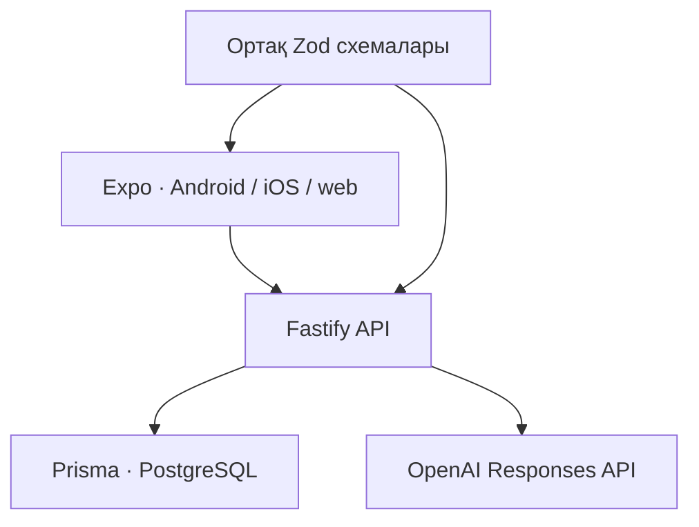

# Архитектура

## Шекаралар

React Native экрандары барлық платформаға ортақ. Web-та cookie, native-та SecureStore арқылы сақталған bearer токен қолданылады. TanStack Query сервер деректерінің жүктелуін, қателерін және жаңаруын басқарады. Ойын конструкторы мұғалім/оқушы үшін біреу.

## Негізгі деректер

| Модель | Міндеті |
| --- | --- |
| User | Пошта, ат/лақап ат, рөл, bcrypt password hash. |
| AuthSession | Кездейсоқ 256-bit токеннің SHA-256 хэші және 7 күндік мерзім. Қонақта userId бос. |
| Game | Автор, өңделетін draft JSON, материал, уақыт шегі, күйі және optimistic revision. |
| GameVersion | Өзгермейтін мазмұн, материал, уақыт шегі және демо белгісінің көшірмесі. |
| Task | Нұсқа ішіндегі тұрақты тапсырма ID-і, орны және мазмұны. |
| ShareSession | 64-bit кездейсоқ 16 таңбалы код, жарияланған нұсқа, active белгісі. |
| Attempt | Қатысушы, нақты нұсқа, сервер уақыты, жабық жауап кілті, ашық араластырылған көрініс және нәтиже. |
| Answer | Attempt + Task бойынша бірегей жауап жазбасы. |
| GenerationJob | Автор, idempotency key, request hash, режим, күй, нәтиже не қауіпсіз error code. |

Game өзгерісі бұрынғы GameVersion-ды өзгертпейді. Жариялау транзакциясы ойын бойынша PostgreSQL advisory lock алады, жаңа нұсқа жасайды, бұрынғы кодтарды жабады және жаңа код қайтарады. Жеке жаттығу да жеке өзгермейтін нұсқамен орындалады.

Draft сақтау `revision` арқылы параллель өңдеудің үстінен үнсіз жазудан қорғайды. Жариялау алдында `reviewed=true` және ағымдағы revision керек. Тексеру UI-де нақты құсбелгі арқылы расталады.

## Ойын және ұпай

| Түрі | Ереже |
| --- | --- |
| Викторина | Дұрыс option ID = 1 ұпай, өзге/бос = 0. |
| Сәйкестендіру | Дұрыс left → right жұбы = 1 ұпай. |
| Реттілік | Бүкіл correctOrder дәл сәйкес болса = 1 ұпай; жартылай ұпай жоқ. |

Пайыз = round(дұрыс / тапсырма саны × 100). Сәйкестендіруде әр жұп жеке тапсырма саналады. 5/10/15 — сұрақ, жұп немесе реттілік тапсырмасының саны; бір реттілік тапсырмасында 3–8 элемент бар.

Сервер әр әрекетте жауап нұсқаларының, жұп жақтарының және реттілік элементтерінің opaque ID-лерін жаңадан жасайды. Жауаптар араластырылады. PublicGame ішінде дұрыс жауап ID-лері, жұп байланыстары, түсіндірмелер, дәлелдер немесе бастапқы материал жоқ. Материал кейде дұрыс жауапты ашып қоятындықтан, оны да басталған әрекетке бермейміз.

Клиент ұпай жібере алмайды: submit схемасында тек `answers` бар, бөгде өрістер қабылданбайды. Ұпай серверде есептеледі. Нәтиже және Answer жазбалары бір транзакцияда сақталады; completedAt бос жазбаны ғана өзгерту қайталанған submit-ті тұрақты нәтижеге айналдырады.

Уақыт шегі сервердегі басталу сәтінен есептеледі. Клиент уақытын өзгерту ұпайға әсер етпейді. UI уақыт біткенде жауаптарды автоматты жібереді. Желі үшін 5 секунд рұқсат етіледі; одан кейін жеткен жауаптар 0 ұпай алады және timedOut көрсетіледі. Байланыс жоғалған кезде офлайн жауап сақтау әзірге жоқ.

## Қолжетімділік және сессиялар

- Әр авторлық операция `ownerId`-ді серверде тексереді. Жасырылған UI батырмаларына сенбейді.
- Мұғалім тек өзінің ойын аналитикасын көреді. Оқушы тек өзінің тарихын және әрекеттерін көреді.
- Қонақ нәтижеге өзінің серверлік сессиясы арқылы ғана кіреді.
- Web: HttpOnly, SameSite=Lax cookie; production-да Secure және `__Host-` атауы. Браузер сақтау орнына құпия токен жазылмайды.
- Native: Expo SecureStore, WHEN_UNLOCKED_THIS_DEVICE_ONLY. Пароль сақталмайды.
- State-changing web сұраныстарының Origin-і тексеріледі. Native режимі Origin жоқ кезде ғана іске қосылады; browser CORS бөтен origin-ге custom headers жіберуге рұқсат бермейді.
- Пароль bcryptjs арқылы 12 cost-пен хэштеледі; UTF-8 бойынша 72 byte шегі тексеріледі.
- Құпия header, cookie, пароль, бастапқы материал және провайдер error body журналға жазылмайды.
- UI барлық енгізілген мәтінді React Native Text ретінде көрсетеді, HTML орындалмайды.
- Auth/join және жалпы HTTP rate limit бар. Reverse proxy артында IP баптауы: DEPLOYMENT.md.

## Қатысушы мен әрекетті санау

Аккаунт үшін `user:<id>`, қонақ үшін `guest:<sessionId>` тұрақты кілті қолданылады. Лақап ат идентификатор емес: аттас екі адам бір адамға біріктірілмейді. Retry жаңа Attempt жасайды, бірақ participantKey өзгермейді. Аналитика бір қатысушының ең жақсы және ең соңғы нәтижесін бөлек береді. Орташа барлық аяқталған сынып әрекеттері бойынша есептеледі. Автордың жеке practice әрекеттері сынып аналитикасына қосылмайды.

Қонақ cookie-сін өшірсе, басқа браузерге көшсе немесе сессиясы бітсе, оны бұрынғы қонақпен сенімді байланыстыра алмаймыз. Тұрақты бірнеше құрылғы тарихы үшін оқушы аккаунты керек.

## ЖИ

Тақырыптан сабақ жасау ағыны `LessonInputSchema` → `OpenAILessonProvider` → `LessonSchema` жолымен өтеді. `lessonGeneration.ts` тақырыптан түсіндірме, мысал, сөздік, үй тапсырмасы, слайдтар және ойынды бірге сұрайды. Тапсырма дәлелі жасалған бөлім мәтінінен алынады; бұл сыртқы дереккөздің дұрыстығын растау емес. Оқулық мәтінінен ойын жасайтын бұрынғы ағын бөлек сақталған.

Ойын мен сабақ `Lesson` кестесіне бір транзакцияда сақталады, `GenerationJob` сол транзакцияда completed күйіне өтеді. Екі ағын `reserveGeneration` арқылы ортақ quota мен idempotency-ді пайдаланады. Сабақ, оның тізімі және PPTX экспорты иесінің сессиясымен ғана ашылады. PPTX серверде, ал дыбыссыз слайд видеосы браузердің Canvas/MediaRecorder мүмкіндіктерімен жасалады; олар жаңа ақылы ЖИ сұранысын жасамайды.

`LLMProvider` интерфейсін `OpenAIResponsesProvider` іске асырады. Тікелей Responses HTTP endpoint, `text.format.json_schema`, `strict=true`, `store=false`. OpenAI SDK міндетті емес. Басқа провайдер үшін бөлек адаптер керек.

Промт `apps/api/src/prompts.ts` ішінде. Material JSON өрісіндегі сенімсіз дерек ретінде жіберіледі; оның бұйрықтары нұсқаулық емес. ЖИ код жасамайды. Әр типке JSON схема бөлек. Жауапта жеткіліксіз материал күйі бар.

Сервер: Zod құрылымын, бос жолдарды, global duplicate ID, жауапқа сілтемелерді, жұптардың бірмәнділігін, толық реттілікті, тапсырма санын, сұралған metadata-ны және дәлелдің материалда сөзбе-сөз болуын тексереді. Ең көбі бір түзету сұранысы жасалады. Ақау демо деректермен алмастырылмайды.

Фактінің дұрыстығы, A/B/C педагогикалық сапасы мен мәтіннің толық тілдік тазалығы автоматты схемамен дәлелденбейді. Сондықтан автордың мазмұнды тексеруі міндетті.

Генерация лимиттері PostgreSQL транзакциясымен резервтеледі. Қайталанған key бір job нәтижесін қайтарады, өзгерген body сол key-мен қабылданбайды. Сәтсіз job да лимитке есептеледі, себебі провайдер шақыруы ақы алуы мүмкін. Әр job ең көбі екі сұраныс пен шектелген input/output көлеміне ие. HTTP rate limit бір процесс жадында, daily budget барлық instance үшін база арқылы ортақ.
